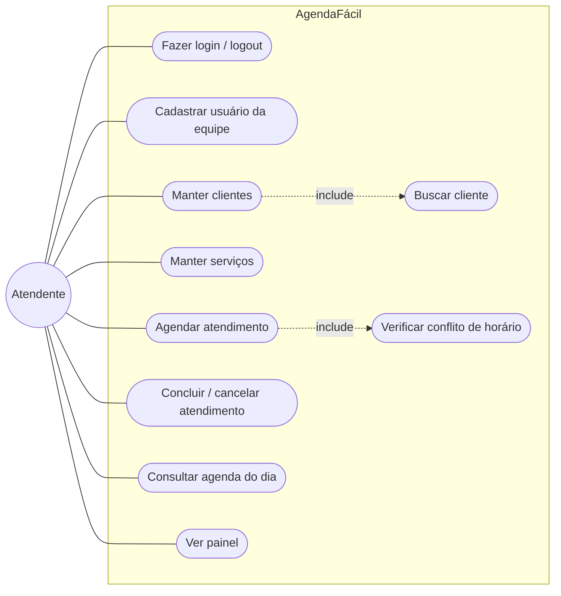
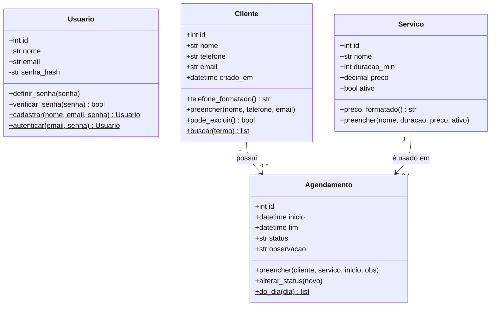
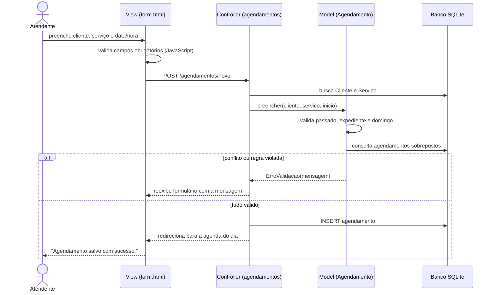
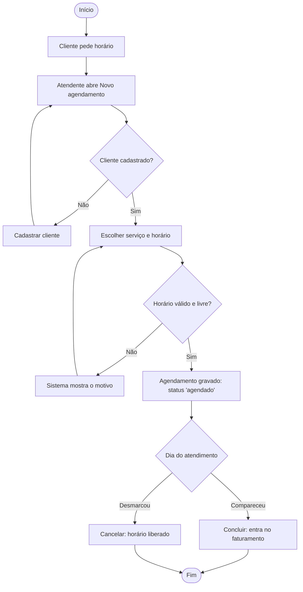
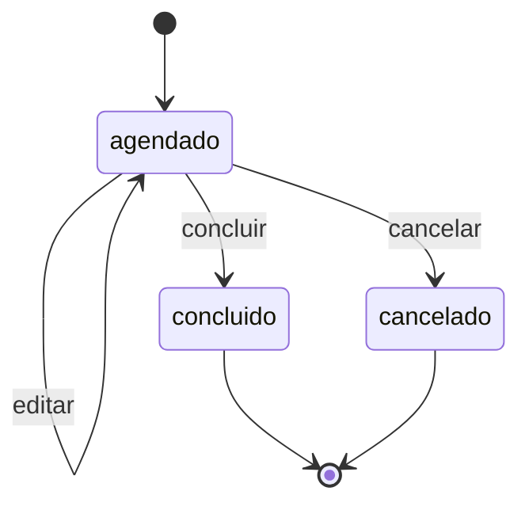

# 2. Modelagem UML (revisada)

> Os diagramas estão em **Mermaid** e aparecem desenhados automaticamente no GitHub.

## 2.1 Diagrama de casos de uso

| Caso de uso | Descrição resumida |
|---|---|
| UC06 Agendar atendimento | O atendente escolhe cliente, serviço e data/hora. O sistema calcula o término, valida passado, expediente, domingo e conflito (UC07). Se tudo estiver certo, grava e mostra a agenda do dia; senão, exibe a mensagem do erro e mantém os dados preenchidos. |
| UC08 Concluir/cancelar | Disponível só para agendamentos em aberto. Cancelar libera o horário. |

## 2.2 Diagrama de classes (persistência)

## 2.3 Diagrama de sequência – Agendar atendimento

## 2.4 Diagrama de atividades – Ciclo do atendimento

## 2.5 Diagrama de estados – Agendamento

