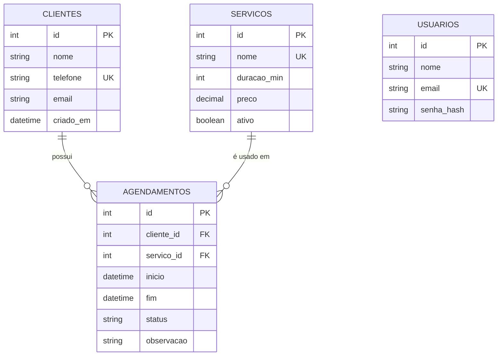

# 3. Projeto de Banco de Dados

SGBD escolhido: **SQLite** (acessado pelo ORM SQLAlchemy). É um dos bancos mais usados do mundo, não exige servidor e é suportado nativamente pelo Python e pela hospedagem PythonAnywhere. Como o acesso é feito pelo ORM, migrar para **PostgreSQL** ou **MySQL** exige apenas configurar a variável de ambiente `DATABASE_URL`.

## 3.1 Projeto conceitual (DER)

Cardinalidades: um cliente tem **0 ou N** agendamentos; cada agendamento pertence a **exatamente 1** cliente e **1** serviço. A tabela `usuarios` é independente (controle de acesso).

## 3.2 Projeto lógico normalizado

- **USUARIOS** (<u>id</u>, nome, email, senha_hash)
- **CLIENTES** (<u>id</u>, nome, telefone, email, criado_em)
- **SERVICOS** (<u>id</u>, nome, duracao_min, preco, ativo)
- **AGENDAMENTOS** (<u>id</u>, *cliente_id* → CLIENTES, *servico_id* → SERVICOS, inicio, fim, status, observacao)

**Normalização:**

- **1FN:** todos os atributos são atômicos (telefone guardado só com dígitos; sem listas em campos).
- **2FN:** todas as chaves primárias são simples (`id`), logo não há dependência parcial.
- **3FN:** não há dependência transitiva — dados do cliente e do serviço ficam nas suas tabelas e o agendamento guarda apenas as chaves estrangeiras.
- **Observação de projeto:** `fim` poderia ser derivado de `inicio + servico.duracao_min`, mas é **armazenado de propósito** para (a) preservar o horário real se a duração do serviço mudar depois e (b) permitir a consulta de conflito diretamente no banco (`inicio < novo_fim AND fim > novo_inicio`).

## 3.3 Projeto físico

O script completo está em [`database/schema.sql`](../../database/schema.sql). Restrições implementadas:

- `PRIMARY KEY` em todas as tabelas; `UNIQUE` em `usuarios.email`, `clientes.telefone` e `servicos.nome`
- `FOREIGN KEY` de `agendamentos` para `clientes` e `servicos`
- `CHECK (status IN ('agendado','concluido','cancelado'))`
- `CHECK (fim > inicio)`

## 3.4 Dicionário de dados

### Tabela `usuarios` — usuários com acesso ao sistema

| Campo | Tipo | Nulo | Chave | Domínio / Regra | Descrição |
|---|---|---|---|---|---|
| id | INTEGER | Não | PK | autoincremento | Identificador do usuário |
| nome | VARCHAR(100) | Não | | mín. 2 caracteres | Nome completo |
| email | VARCHAR(120) | Não | UK | formato de e-mail, minúsculo | Login do usuário |
| senha_hash | VARCHAR(255) | Não | | hash (Werkzeug) de senha com mín. 6 caracteres | Senha criptografada |

### Tabela `clientes` — clientes atendidos pelo salão

| Campo | Tipo | Nulo | Chave | Domínio / Regra | Descrição |
|---|---|---|---|---|---|
| id | INTEGER | Não | PK | autoincremento | Identificador do cliente |
| nome | VARCHAR(100) | Não | | mín. 2 caracteres | Nome do cliente |
| telefone | VARCHAR(11) | Não | UK | só dígitos, 10 ou 11 (DDD + número) | Telefone/WhatsApp |
| email | VARCHAR(120) | Sim | | formato de e-mail | E-mail opcional |
| criado_em | DATETIME | Não | | data/hora atual | Data do cadastro |

### Tabela `servicos` — serviços oferecidos

| Campo | Tipo | Nulo | Chave | Domínio / Regra | Descrição |
|---|---|---|---|---|---|
| id | INTEGER | Não | PK | autoincremento | Identificador do serviço |
| nome | VARCHAR(80) | Não | UK | mín. 2 caracteres, único sem diferenciar maiúsculas | Nome do serviço |
| duracao_min | INTEGER | Não | | 5 a 480 | Duração em minutos |
| preco | NUMERIC(8,2) | Não | | ≥ 0 | Preço em reais |
| ativo | BOOLEAN | Não | | verdadeiro/falso (padrão: verdadeiro) | Se pode ser agendado |

### Tabela `agendamentos` — atendimentos marcados

| Campo | Tipo | Nulo | Chave | Domínio / Regra | Descrição |
|---|---|---|---|---|---|
| id | INTEGER | Não | PK | autoincremento | Identificador do agendamento |
| cliente_id | INTEGER | Não | FK → clientes.id | cliente existente | Cliente atendido |
| servico_id | INTEGER | Não | FK → servicos.id | serviço ativo no momento do agendamento | Serviço realizado |
| inicio | DATETIME | Não | | futuro; seg–sáb; ≥ 08:00 | Início do atendimento |
| fim | DATETIME | Não | | inicio + duração; ≤ 20:00; `fim > inicio` | Término previsto |
| status | VARCHAR(10) | Não | | `agendado`, `concluido`, `cancelado` | Situação |
| observacao | VARCHAR(255) | Sim | | até 255 caracteres | Anotações livres |
