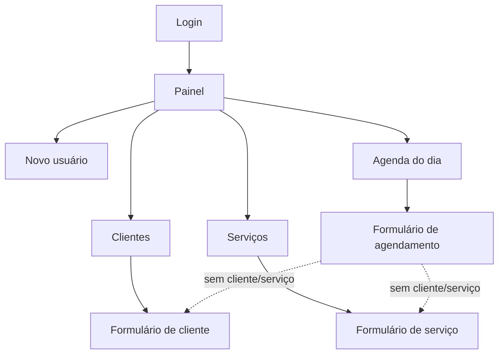

# 4. IHC – Interface Humano-Computador e Protótipo

## 4.1 Mapa de navegação

## 4.2 Telas (protótipo funcional)

As telas reais do sistema estão em [`docs/situacao-2-codificacao/telas`](../situacao-2-codificacao/telas):

| Tela | Arquivo |
|---|---|
| Login | `1_login.png` |
| Lista de serviços | `2_servicos.png` |
| Validação de formulário | `3_validacao.png` |
| Lista de clientes | `4_clientes.png` |
| Agenda do dia | `5_agenda.png` |
| Mensagem de conflito de horário | `6_conflito.png` |
| Painel | `7_painel.png` |
| Versão para celular | `8_mobile.png` |

## 4.3 Princípios de IHC aplicados

| Princípio (material teórico) | Como foi aplicado |
|---|---|
| **Clara** | Rótulos em português, campos obrigatórios marcados com `*`, dica do horário de funcionamento no formulário. |
| **Consistente** | Todas as listas seguem o mesmo padrão (título, botão "+ Novo", tabela, ações Editar/Excluir); cores fixas para status. |
| **Simples** | Só 4 itens de menu; formulários curtos; máscara automática de telefone. |
| **Controlada pelo usuário** | Nada é gravado sem o clique em "Salvar"; botões "Cancelar/Voltar" em todos os formulários. |
| **Direta** | Após salvar, o usuário vê imediatamente o item na lista/agenda. |
| **Recuperável** | Confirmação antes de excluir/cancelar; dados digitados são mantidos quando há erro; serviço com histórico é desativado em vez de apagado. |
| **Dá resposta (feedback)** | Mensagens verdes de sucesso, vermelhas de erro e amarelas de aviso; erro destacado no próprio campo. |
| **Acessível / responsiva** | Layout adaptado a celular (menu ☰ e tabela em cartões), contraste adequado, foco visível nos campos. |

## 4.4 Catálogo de mensagens

| Situação | Mensagem exibida | Tipo |
|---|---|---|
| Login incorreto | E-mail ou senha incorretos. | Erro |
| Campo vazio | Campo obrigatório. | Erro (no campo) |
| Telefone inválido | Telefone inválido. Use DDD + número, ex.: (61) 99999-9999. | Erro |
| Telefone repetido | Já existe um cliente com este telefone. | Erro |
| Horário ocupado | Conflito de horário com *Nome* (*hh:mm–hh:mm*). | Erro |
| Data passada | Não é possível agendar em data/hora passada. | Erro |
| Fora do expediente | Horário fora do funcionamento (08h às 20h). | Erro |
| Domingo | O salão não funciona aos domingos. | Erro |
| Excluir cliente com histórico | Cliente possui agendamentos em aberto e não pode ser excluído. | Erro |
| Excluir serviço usado | Serviço possui agendamentos; foi apenas desativado. | Aviso |
| Texto longo demais | O nome deve ter no máximo 100 caracteres. | Erro |
| Preço acima do limite | Preço máximo permitido: R$ 999.999,99. | Erro |
| Página inexistente | Erro 404 – Página não encontrada. | Página de erro |
| Ação por caminho inválido | Erro 405 – Esta ação não pode ser feita por este caminho. Use os botões do sistema. | Página de erro |
| Falha interna | Erro 500 – Ocorreu um erro interno. Tente novamente em instantes. | Página de erro |
