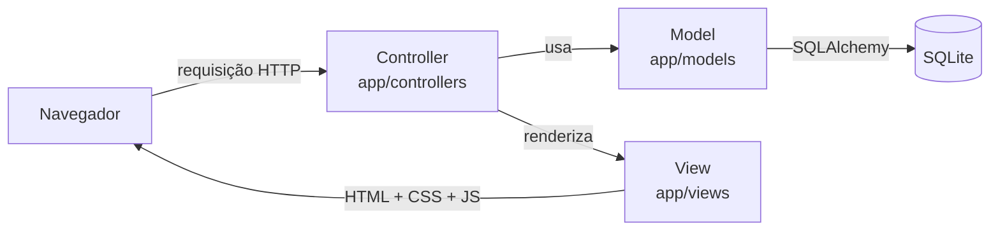

# Arquitetura – padrão MVC

O AgendaFácil segue o padrão **Model–View–Controller**, indicado no material da disciplina.

| Camada | Pasta | Responsabilidade |
|---|---|---|
| **Model** | `app/models/` | Classes `Usuario`, `Cliente`, `Servico`, `Agendamento`. Contêm **todas as regras de negócio** (validação de telefone, conflito de horário, expediente, status). Erros de regra são lançados como `ErroValidacao`. |
| **Controller** | `app/controllers/` | Um *Blueprint* por módulo (`auth`, `painel`, `clientes`, `servicos`, `agendamentos`). Recebe a requisição, chama o Model, trata `ErroValidacao` exibindo a mensagem e decide qual View mostrar. O decorador `login_obrigatorio` protege as rotas. |
| **View** | `app/views/` | Templates Jinja2 que herdam de `base.html`. Não possuem regra de negócio, só apresentação. |
| Front-end | `app/static/` | `style.css` (layout responsivo) e `app.js` (máscara de telefone, validação no navegador, confirmação de exclusão). |

## Tratamento de erros

- **Erros de regra de negócio** → `ErroValidacao` → mensagem amigável no topo da tela, dados do formulário preservados, `rollback` da transação.
- **Erros HTTP** → páginas próprias para 400 (CSRF/requisição inválida), 404 (registro ou página inexistente), 405 (método não permitido) e 500 (erro interno, com `rollback`).
- **Fuso horário:** a função `agora()` (em `app/models/__init__.py`) devolve a hora de Brasília mesmo que o servidor esteja em UTC, como acontece no PythonAnywhere.
- **Validação dupla:** no navegador (JavaScript, resposta imediata) e no servidor (Model, garantia de integridade mesmo se o JavaScript for burlado).

## Segurança

- Senhas com *hash* (`werkzeug.security`).
- Token **CSRF** em todos os formulários `POST`.
- Consultas via ORM (proteção contra SQL Injection) e *autoescape* do Jinja2 (proteção contra XSS).
- Rotas internas exigem sessão autenticada, inclusive o cadastro de novos usuários.
- Tamanho dos textos validado no servidor (não só no navegador).

## Bibliotecas

| Biblioteca | Uso |
|---|---|
| Flask | Framework web (rotas, sessões, templates) |
| Flask-SQLAlchemy | ORM e acesso ao banco |
| Werkzeug | Hash de senhas (já incluso no Flask) |
| pytest | Testes automatizados |
